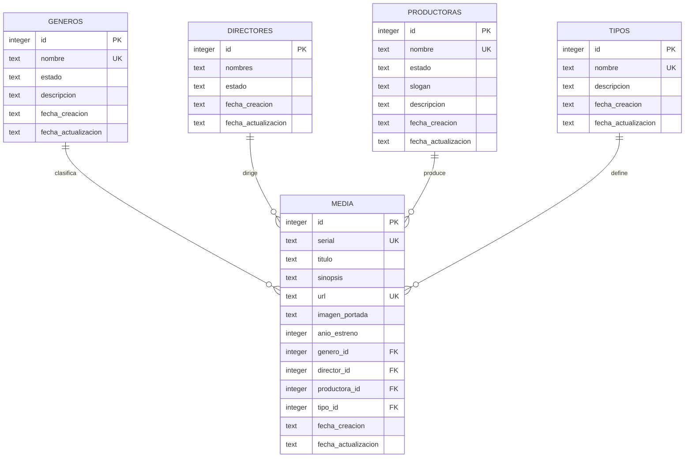

# Diseño de la base de datos y trazabilidad

## Modelo relacional

Cardinalidad: un catálogo puede tener cero o muchas producciones; cada producción necesita un registro de cada catálogo. No se requieren tablas puente porque el caso limita la asignación a un género, un director principal, una productora principal y un tipo.

## Diccionario y decisiones

`id`: entero autogenerado, clave primaria. Las fechas son texto ISO 8601 UTC, generado por la API. Todos los campos definidos son NOT NULL. Las fechas no forman parte de los cuerpos editables.

| Tabla | Campos propios | Restricciones |
| --- | --- | --- |
| generos | nombre TEXT, estado TEXT, descripcion TEXT | Nombre único; estado Activo/Inactivo |
| directores | nombres TEXT, estado TEXT | Homónimos permitidos; estado Activo/Inactivo |
| productoras | nombre TEXT, estado TEXT, slogan TEXT, descripcion TEXT | Nombre único; estado Activo/Inactivo |
| tipos | nombre TEXT, descripcion TEXT | Nombre único; sin estado |
| media | serial TEXT, titulo TEXT, sinopsis TEXT, url TEXT, imagen_portada TEXT, anio_estreno INTEGER, genero_id INTEGER, director_id INTEGER, productora_id INTEGER, tipo_id INTEGER | Serial y URL únicos; cuatro FK obligatorias; año 1888-9999 |

Las cuatro FK tienen índices para consultas relacionales y `ON DELETE RESTRICT`. Los nombres de los catálogos se almacenan en sus tablas y no se duplican como columnas en media. Los objetos relacionados que devuelve GET se construyen al consultar, por lo que reflejan su nombre y estado actuales.

Los límites de longitud y la validez de las URL se comprueban en la API. SQLite añade tipos STRICT, NOT NULL, CHECK, UNIQUE, FK y triggers para las reglas críticas. La API usa consultas parametrizadas y una lista fija de tablas y columnas.

El diseño permite desactivar un catálogo manteniendo referencias históricas. Reasignar una producción a otro catálogo exige que el nuevo registro esté activo. El seed es transaccional e idempotente.

## Trazabilidad con el caso

| Requisito | Implementación | Verificación |
| --- | --- | --- |
| Registrar y editar género | `/api/generos`, campos y fechas | Ciclo CRUD del módulo |
| Registrar y editar director | `/api/directores`, nombres y estado | Ciclo CRUD del módulo |
| Registrar y editar productora | `/api/productoras`, slogan y descripción | Ciclo CRUD del módulo |
| Registrar y editar tipo | `/api/tipos`, sin estado | Ciclo CRUD del módulo |
| CRUD de películas y series | `/api/media`, cuatro relaciones | Ciclo CRUD y objetos relacionados |
| Serial y URL únicos | Dos restricciones UNIQUE | Duplicados al crear y actualizar |
| Seleccionar catálogos activos | Validación y triggers | Rechazo de relaciones inactivas |
| Catálogos iniciales | `npm run seed` | Cinco géneros y dos tipos, sin duplicados |
| Prueba en cliente REST | Colección de Postman | Ejecución ordenada con IDs dinámicos |
| Persistencia | Archivo SQLite | Cierre y reapertura sin pérdida |

## Estructura

`src/app.js` configura las rutas; `src/service.js` ejecuta las operaciones de los cinco módulos; `src/modules.js` declara sus campos; `src/validation.js` valida los datos; `src/errors.js` uniforma los errores; `src/database.js` abre y prepara SQLite; `src/server.js` inicia el servidor. La configuración declarativa evita repetir el mismo CRUD sin mezclar los campos específicos de cada recurso.
